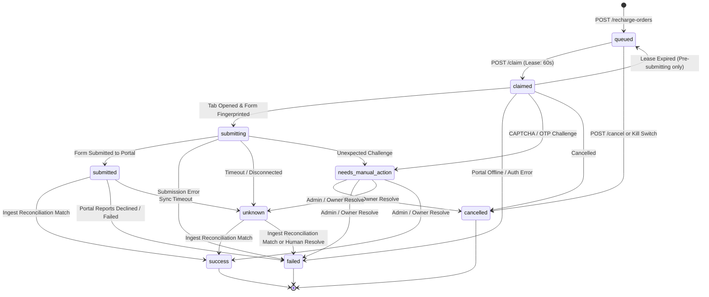

# ADR 006: Web-Initiated Automated Recharge Architecture & Execution Protocol

**Status:** Accepted  
**Date:** 2026-11-06  
**Context:** Retailer Automated Recharge from Web App to Distributor Portals  

---

## 1. Context & Problem Statement

Retail telecom merchants in India frequently manage balances across multiple distributor portals (`simplewallet.in`, `egpayment.com`). Previously, retailers had to keep each portal open in separate tabs, manually re-enter customer mobile numbers, select operators, and type amounts on each portal form.

To eliminate manual typing errors, minimize customer wait time, and provide unified tracking across portals, WalletSync introduces **"Recharge from Web App"**: retailers initiate recharges directly from the web dashboard, and their paired POS browser extension automates the form submission on the appropriate distributor portal in a non-active background tab.

Because this introduces real financial actions, the system must enforce ironclad security boundaries, zero plain PII leakage, double-submission prevention, and defense-in-depth financial limits.

---

## 2. Core Architectural Principles & Invariants

### 1. Database-Only Order Storage (Zero Memory Fallback)
* Financial orders must **never** be stored in ephemeral memory stores.
* If PostgreSQL / Neon is unavailable, endpoints return `503 Service Unavailable`.
* Every query runs strictly inside `withTenantContext(tenantId, ...)` with PostgreSQL Row-Level Security (`FORCE ROW LEVEL SECURITY`).

### 2. Default-Off Feature Isolation (Per-Tenant Kill Switch)
* Automated recharge is disabled by default (`recharge_enabled = false`).
* Toggling the switch to `false` immediately cancels all pending `queued` orders and writes an immutable record to `audit_log`.

### 3. PII & Secret Minimization
* Full customer mobile numbers are encrypted at rest using AES-256-GCM (`encryptCustomerNo(phone, tenantId)`).
* Plain phone numbers are never returned in list endpoints or logged in console/audit logs.
* Search and duplicate checks use HMAC-SHA256 blind indexing (`customer_no_hash`) and plaintext `customer_last4`.
* Decryption occurs **only** on-demand when an authenticated device claims an order for execution.

### 4. Integer Paise Currency
* All monetary values are represented as positive integers in paise (`amount_paise`), eliminating floating-point rounding errors.

---

## 3. Finite State Machine & Lifecycle Protocol

Order state transitions follow an explicit, mathematically verified state machine:

### Critical State Machine Invariants:
1. **Irreversible `submitting` Lock:** Once an order reaches `submitting`, it can **never** return to `queued` or `claimed`. This eliminates double-submission even if the extension crashes or disconnects.
2. **Terminal States:** `success`, `failed`, and `cancelled` are strictly immutable.

---

## 4. Multi-Layer Protection & Concurrency Controls

1. **Mandatory Client Idempotency (`Idempotency-Key`):**
   - Header is required on `POST /api/v1/recharge-orders`.
   - Matching key + body returns existing order (200).
   - Matching key + differing body returns `409 Conflict`.
2. **Per-Tenant Advisory Locks:**
   - Every creation request obtains `pg_advisory_xact_lock` on tenant ID hash, serializing concurrent orders per tenant.
3. **10-Minute Duplicate Guard:**
   - Orders matching `(customer_no_hash, amount_paise)` within 10 minutes return `409 Conflict` unless the retailer explicitly acknowledges `confirmDuplicate: true`.
4. **Asia/Kolkata Calendar Day Limits:**
   - Daily spending caps compute calendar day boundaries at 00:00 IST (`Asia/Kolkata`), preventing UTC boundary skew.
5. **Atomic Lease Allocation:**
   - Extension workers claim orders using `SELECT ... FOR UPDATE SKIP LOCKED`. Exactly one terminal secures the lease.

---

## 5. In-Tab Execution & Anti-Bot Safeguards

1. **Dedicated Non-Active Tabs:**
   - Forms execute in background tabs (`chrome.tabs.create({ active: false })`) to avoid disrupting active retailer windows.
   - Dedicated tab references are tracked in `tab-manager.ts` and closed immediately upon completion.
2. **Form Fingerprinting & Round-Trip Verification:**
   - The runner verifies DOM selectors for mobile input, operator dropdown, amount, and submit button.
   - Before firing the click event, values are read back from DOM elements to confirm exact round-trip match (`input.value === order.customerNo`).
3. **Fail-Closed Challenge Handling:**
   - Any detected CAPTCHA, OTP, or Cloudflare Turnstile challenge immediately aborts clicking and advances the order to `needs_manual_action`. Automated bypass is strictly forbidden.

---

## 6. Portal Ingest Reconciliation Engine

1. Ingested portal transactions from periodic history extraction or Direct HTML Ingest are matched within `withTenantContext`:
   - Matching fields: `tenant_id`, `source`, `customer_no_hash`, `amount_paise`.
   - Candidate status: `submitting`, `submitted`, `unknown` with `matched_transaction_id IS NULL`.
2. Upon match, the order is updated to `success` or `failed`, populating `matched_transaction_id` and `reconciled_at`.
3. An audit log entry (`reconcile_recharge_order`) is recorded without plaintext customer numbers.

---

## 7. Status & Compliance

- **Unit & Integration Coverage:** Verified by `recharge.test.ts`, `messages.test.ts`, `recharge-orders.test.ts`, `recharge-claim.test.ts`, `reconciliation.test.ts`, and `recharge-e2e-flow.test.ts`.
- **Zero Plain PII Invariant:** Continuous runtime compliance enforced via `scripts/scan-pii-secrets.mjs`.

