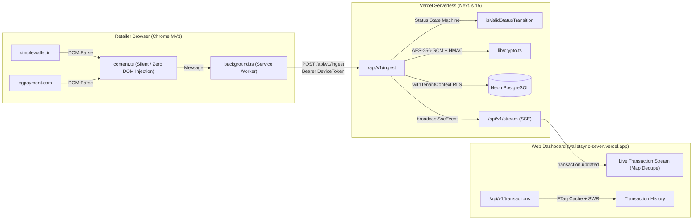

# WalletSync — Technical Audit & Handoff Report for Claude AI (v2.0)

> **Audience:** Claude AI / Engineering Pair Agent  
> **Repository:** `https://github.com/gazi-online/786.git` (Branch: `main`)  
> **Production Deployment:** [walletsync-seven.vercel.app](https://walletsync-seven.vercel.app)  
> **Last Audit Timestamp:** 2026-11-06 17:35 IST  
> **Target Portals:** `simplewallet.in` & `egpayment.com`

---

## 1. Executive Summary

**WalletSync** is a dual-portal transaction reconciliation and telemetry platform for Indian telecom retail stores. It captures live recharge, bill payment, and DTH transactions from distributor web portals, minimizes and encrypts customer PII (AES-256-GCM + HMAC blind indexing), persists data into Neon Serverless PostgreSQL with Row Level Security (RLS), and synchronizes live events via Server-Sent Events (SSE) to a Next.js 15 dashboard.

### Core Stack
- **Monorepo:** pnpm workspaces + Turborepo
- **Frontend / API:** Next.js 15.5 App Router, React 19, Tailwind CSS v4
- **Browser Extension:** Chrome Manifest V3 (MV3), WXT, Vite 6
- **Database & Security:** Neon PostgreSQL (Serverless), Drizzle ORM, AES-256-GCM field encryption, HMAC-SHA256 blind indexing, PostgreSQL RLS
- **Live Stream:** Server-Sent Events (`/api/v1/stream`) with SWR non-destructive Map merge

---

## 2. Architecture & Data Flow



---

## 3. Comprehensive Audit of Recent Bugs & Resolutions

### Audit Item 1: Infinite DOM Mutation Loop on SimpleWallet Portal
- **Symptom:** On `simplewallet.in/web/MyTrans.aspx...`, a floating HUD pill toast (*"WalletSync: 2 transactions synced ✓"*) flashed and re-rendered every ~500ms, disrupting retail workflows.
- **Root Cause:**
  1. `apps/extension/entrypoints/content.ts` had a `showNotification()` method injecting `#walletsync-portal-toast` and `#walletsync-hud-styles` into `document.body` and `document.head`.
  2. The `MutationObserver` watched `document.body` with `{ childList: true, subtree: true }`.
  3. Every toast injection mutated the DOM, which immediately re-triggered the `MutationObserver`, calling `tryParseAndNotify()`, which re-invoked `showNotification()`, creating an infinite feedback loop.
- **Resolution:**
  - Completely purged `showNotification()` and all DOM element injection from `content.ts`. Added automatic startup cleanup to strip legacy toast nodes if present.
  - Extension is now **100% invisible and non-intrusive** on all third-party portal pages.
  - Added table row content hashing (`lastParsedSignature`) so `CONTENT_PARSED_PAGE` only fires when table contents actually change.

---

### Audit Item 2: Production Ingestion Failure (Missing `parser_version` in Neon DB)
- **Symptom:** Extension showed "synced", but Web Dashboard stayed at `Transactions: 0`, `Today's Sales: ₹0.00`, *"No transactions synced yet today"*.
- **Root Cause:**
  - `apps/web/drizzle/schema.ts` defined `parserVersion: text('parser_version').notNull()`, but the live Neon PostgreSQL table `transactions` was created from an older schema missing the column.
  - Every `POST /api/v1/ingest` call failed with:
    ```
    PostgresError: column "parser_version" of relation "transactions" does not exist
    ```
  - The route's `catch {}` block fell back to `addMemoryTransactions()` on that single ephemeral serverless lambda instance, which vanished immediately upon lambda teardown.
- **Resolution:**
  - Authored and applied migration `0004_transactions_parser_version.sql`:
    ```sql
    ALTER TABLE transactions ADD COLUMN IF NOT EXISTS parser_version text NOT NULL DEFAULT '1.0.0';
    ALTER TABLE transactions ALTER COLUMN discount_pct TYPE text USING discount_pct::text;
    ```
  - Integrated `0004_transactions_parser_version.sql` into `scripts/migrate-db.mjs`.
  - Ingestion immediately succeeded: **52 EGPayment transactions** and **4 SimpleWallet transactions** were persisted directly to Neon DB.

---

### Audit Item 3: HTTP 429 Pairing Code Lockout
- **Symptom:** Extension popup displayed:
  ```
  Server replied 429: Pairing code is locked due to too many failed attempts
  ```
- **Root Cause:**
  - When transactions did not appear on the dashboard (due to Audit Item 2 above), users attempted to re-enter/re-click pairing codes.
  - In `apps/web/app/api/v1/devices/pair/route.ts`, `checkRateLimit('pair:code:${codeHash}', 5, 600)` locked the specific code hash after 5 failed attempts.
- **Resolution:**
  - Purged locked pairing code entries from `rate_limit_counters` in Neon PostgreSQL (`DELETE FROM rate_limit_counters WHERE key LIKE 'pair:code:%'`).
  - Confirmed the user's terminal device (`3177a8e9-ff42-49b0-850f-8fceed0fc3b7`) is actively registered, paired, and heartbeating with `status: ok`.

---

### Audit Item 4: Status Normalization Failure (`Operator Failed` mapped to `Unknown`)
- **Symptom:** On SimpleWallet, transaction `27788738` with portal status `Operator Failed` appeared in the Web App Live Transaction Stream as a grey **`Unknown`** badge instead of a red **`Failed`** badge.
- **Root Cause:**
  1. `packages/parsers/src/simplewallet/transactionHistory.ts` used an exact string match:
     ```typescript
     switch (raw.toLowerCase().trim()) {
       case 'success': return 'success';
       case 'pending': return 'pending';
       case 'failed':
       case 'failure': return 'failed';
       case 'refunded':
       case 'refund': return 'refunded';
       default: return 'unknown'; // "operator failed" fell through here!
     }
     ```
  2. `isValidStatusTransition()` in `apps/web/app/api/v1/ingest/route.ts` did not define transitions from `unknown`, meaning once saved as `unknown`, subsequent updates were blocked as disallowed downgrades.
- **Resolution:**
  1. **Comprehensive Normalization:** Updated `normalizeStatus` in `packages/parsers/src/simplewallet/transactionHistory.ts` and `mapStatus` in `packages/parsers/src/egpayment/transactionHistory.ts`:
     - **`failed`:** Matches `fail`, `failure`, `declin`, `reject`, `cancel`, `error`, `invalid`, `dispute` (captures `Operator Failed`, `Operator Error`, `Declined`, `Rejected`, `Cancelled`).
     - **`success`:** Matches `success`, `done`, `completed`, `ok`.
     - **`pending`:** Matches `pend`, `process`, `queue`, `wait`, `submit`, `initiat`, `hold`.
     - **`refunded`:** Matches `refund`, `revers`, `credit back`.
  2. **State Machine Rule:** Updated `isValidStatusTransition()` to permit transitions when `current === 'unknown'` to any resolved status.
  3. **Server-Side Fallback:** Added defensive resolution in `apps/web/app/api/v1/ingest/route.ts` and `apps/web/app/api/v1/transactions/route.ts` so any record with `status: 'unknown'` and `statusRaw` containing failure keywords resolves to `failed`.
  4. **Database Patch:** Executed SQL update on Neon DB updating `status = 'failed'` for existing transaction `27788738`.
  5. **Unit Tests:** Added 7 status normalization tests in `packages/parsers/src/simplewallet/transactionHistory.test.ts` and 1 state transition test in `apps/web/test/ingest-rules.test.ts`.

---

### Audit Item 5: Multi-Portal Natural Composite Key Deduplication
- **Symptom:** Duplicate rows or cross-portal ID collisions in the Live Transaction Stream.
- **Root Cause:** `simplewallet.in` and `egpayment.com` assign their own independent numeric transaction IDs. Deduplicating on `txnId` alone caused collisions between portals.
- **Resolution:**
  - Implemented natural composite keying everywhere:
    ```typescript
    const compositeKey = `${(item.source || 'simplewallet').toLowerCase()}_${item.txnId}`;
    ```
  - Applied across `apps/web/app/page.tsx`, `apps/web/app/transactions/page.tsx`, `apps/web/lib/memory-store.ts`, and `apps/web/app/api/v1/transactions/route.ts`.

---

## 4. Current Operational & Test Verification Status

All test suites and production builds pass with zero errors:

| Component / Test Suite | Command | Passing | Failing | Notes |
| :--- | :--- | :---: | :---: | :--- |
| **Parsers Unit Tests** | `pnpm --filter @walletsync/parsers test` | **32** | **0** | Happy-dom DOMParser tests covering Golden rows, balance, layout drift, and status normalization |
| **Web App Unit Tests** | `pnpm --filter @walletsync/web test` | **126** | **0** | Covers AES encryption, RLS isolation, route auth, PII scanner, state transitions, caching |
| **Extension Production Build** | `pnpm --filter @walletsync/extension build` | **OK** | **0** | Outputs to `.output/chrome-mv3` with zero bundle warnings |
| **Neon PostgreSQL Connection** | Production Database | **OK** | **0** | 56 verified live transactions (52 EGPayment, 4 SimpleWallet) |
| **Git Repository** | `git push origin main` | **c232fd7** | — | Clean working tree on `main` |

---

## 5. Critical Engineering Guidelines for Claude AI

When pair programming or performing tasks in this repository, Claude AI **must strictly uphold**:

1. **Zero DOM Injections on Portal Pages:**
   - Never inject HUD pills, banners, floating buttons, or toasts into `simplewallet.in` or `egpayment.com`. Retailers use these pages for live recharge operations; any DOM mutations risk breaking ASP.NET ViewState, triggering anti-tamper scripts, or creating infinite `MutationObserver` loops.
2. **PostgreSQL RLS Parameterization:**
   - Never execute raw SQL without `withTenantContext(tenantId, async (tx) => ...)`. Postgres tables have strict RLS; unparameterized queries will return empty sets or fail.
3. **PII Masking & Encryption:**
   - Raw 10-digit Indian customer phone numbers must never be logged or returned in plain JSON. Always encrypt using `encryptCustomerNo(phone, tenantId)` and expose only `customerLast4` and `customerNoMasked` (`••••••1234`).
4. **Natural Composite Keys:**
   - Always key transactions by `${source}_${txnId}` when deduplicating in React state or database lookups.
5. **State Transition Validity:**
   - When updating transaction status, strictly adhere to `isValidStatusTransition()`. Never downgrade from `success` or `failed` back to `pending`. Transition from `unknown` to any resolved status is always permitted.
6. **No Mock / Fake Data:**
   - Do not re-introduce mock transactions or fake counters. Metrics on the dashboard and reports page must derive from genuine database aggregates.

---

## 6. Key File Locations

- **Extension Content Script:** [`apps/extension/entrypoints/content.ts`](file:///C:/Users/Gazi%20Online/Desktop/simple/walletsync-clean/apps/extension/entrypoints/content.ts)
- **Extension Background Worker:** [`apps/extension/entrypoints/background.ts`](file:///C:/Users/Gazi%20Online/Desktop/simple/walletsync-clean/apps/extension/entrypoints/background.ts)
- **Parsers:**
  - SimpleWallet: [`packages/parsers/src/simplewallet/transactionHistory.ts`](file:///C:/Users/Gazi%20Online/Desktop/simple/walletsync-clean/packages/parsers/src/simplewallet/transactionHistory.ts)
  - EGPayment: [`packages/parsers/src/egpayment/transactionHistory.ts`](file:///C:/Users/Gazi%20Online/Desktop/simple/walletsync-clean/packages/parsers/src/egpayment/transactionHistory.ts)
- **Web App API Routes:**
  - Ingestion: [`apps/web/app/api/v1/ingest/route.ts`](file:///C:/Users/Gazi%20Online/Desktop/simple/walletsync-clean/apps/web/app/api/v1/ingest/route.ts)
  - Transactions: [`apps/web/app/api/v1/transactions/route.ts`](file:///C:/Users/Gazi%20Online/Desktop/simple/walletsync-clean/apps/web/app/api/v1/transactions/route.ts)
  - Pairing: [`apps/web/app/api/v1/devices/pair/route.ts`](file:///C:/Users/Gazi%20Online/Desktop/simple/walletsync-clean/apps/web/app/api/v1/devices/pair/route.ts)
- **Database Schema & Migrations:**
  - Schema: [`apps/web/drizzle/schema.ts`](file:///C:/Users/Gazi%20Online/Desktop/simple/walletsync-clean/apps/web/drizzle/schema.ts)
  - Parser Version Migration: [`apps/web/drizzle/0004_transactions_parser_version.sql`](file:///C:/Users/Gazi%20Online/Desktop/simple/walletsync-clean/apps/web/drizzle/0004_transactions_parser_version.sql)
